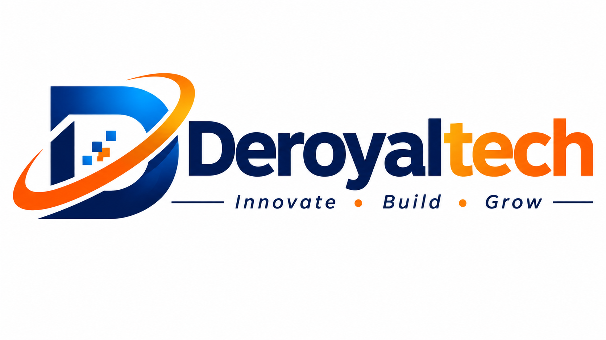

# DeRoyalTech Systems — Enterprise Software, Cloud & Hardware Integration



> **Innovate · Build · Grow**  
> Suite 402, Standard Chartered Building, Airport City & Spintex Tech Corridor, Accra, Ghana  
> Phone: +233 (0) 30 294 8821 / +233 (0) 24 590 1284 · Email: info@deroyaltech.com

DeRoyalTech engineers bespoke web platforms, native mobile applications, custom CRM architectures, and multi-cloud infrastructure—seamlessly integrated with industrial sensors, edge gateways, and enterprise computer peripherals to streamline operations across Ghana and internationally.

---

## 🌟 Key Features

### 1. Unified Engineering Services & Ghanaian Cedis (GH₵) Pricing
- Transparent baseline pricing denominated in **Ghanaian Cedis (GH₵)** to insulate domestic clients from currency volatility.
- Coverage across Web platforms, Native Mobile Apps (iOS/Android), Custom CRM pipelines, Multi-Cloud Kubernetes, Terraform DevOps, and Hardware edge calibration.

### 2. Live Project Milestone Tracker & Automated Client Email Alerts
- Unique Project Tracking IDs (`DRT-2026-XXXX`).
- Real-time progress bar, milestone stages, and live engineering log telemetry.
- **Automated Client Email Notification System**: Dispatches styled branded status emails to clients whenever milestone stages, completion percentages, or QA logs are updated by administrators.
- In-portal email alerts dispatch history and HTML preview dialog.

### 3. Knowledge Base & Self-Serve FAQ Center
- Public and client-accessible Help Center with instant keyword search and category filtering.
- Covers Project Tracking, Custom CRM vs. Off-the-shelf software, Hardware Peripherals, Ghanaian Cedis Escrow Billing, Cloud 99.99% SLAs, and Account Approval.
- Interactive helpfulness voting (`👍 Yes / 👎 No`) with real-time feedback.
- Full AdminPortal management: create, edit, delete, and feature FAQ articles.

### 4. AdminPortal & No-Code CMS Governance
- Complete no-code site administration:
  - **Live Support**: Dedicated real-time chat desk with client threads.
  - **Service Orders & Tracker**: Confirm incoming inquiries, generate Project IDs, adjust completion percentages, and view dispatched email records.
  - **Knowledge Base (FAQ)**: Author and publish self-serve articles.
  - **Services & Pricing**: Modify starting prices and deliverables.
  - **Client Testimonials**: Dynamic partner quotes with smooth sliding animation.
  - **Project Metrics**: Update completed project counters, satisfaction rates, and lines of code written.
  - **Client Approvals & Access Guard**: Role-based access control protecting confidential blueprints until verified by administrators.
  - **Direct Inquiries**: Triage incoming client leads.
  - **Branding, Contact & Social**: Update corporate logo, phone numbers, and official vector social links (WhatsApp, Facebook, TikTok, Instagram, LinkedIn).

### 5. Hardware Catalog & Telemetry Workflows
- Enterprise computer peripherals: Handheld 2D/RFID scanners, 40" 5K IPS displays, Titan Thunderbolt 4 docks, and fanless Xeon IoT edge micro-servers.
- Hardware RFQ cart drawer with Cedis quote totals and direct inquiry conversion.

---

## 🛠️ Technology Stack

- **Frontend**: React 19, TypeScript, Tailwind CSS v4, Lucide Icons, Motion.
- **Backend**: Express.js server (`server.ts`) with production SPA static serving, JSON persistence, and Vite middleware integration.
- **Bundler & Tooling**: Vite 8, esbuild, TypeScript compiler (`tsc`).
- **Deployment Target**: Google Cloud Run & Docker / Node.js production container (`0.0.0.0:$PORT`).

---

## 🚀 Getting Started

### Prerequisites
- Node.js (v20+ or v22+)
- npm or yarn

### Installation
```bash
# Clone the repository
git clone https://github.com/your-username/deroyaltech.git

# Navigate to project directory
cd deroyaltech

# Install dependencies
npm install
```

### Environment Variables
Copy `.env.example` to `.env`:
```bash
cp .env.example .env
```

### Development Server
Run the local dev server (Express + Vite on port 3000):
```bash
npm run dev
```
Open [http://localhost:3000](http://localhost:3000) in your browser.

### Production Build & Launch
```bash
# Type check and build static assets into dist/
npm run build

# Start the production server
npm start
```
The server will bind dynamically to `process.env.PORT` (or default to 3000) on `0.0.0.0`.

---

## 📁 Repository Structure

```
├── .gitignore
├── README.md
├── package.json
├── server.ts                  # Express full-stack API & production server
├── vite.config.ts             # Vite & Tailwind configuration
├── index.html                 # HTML entry with DeRoyalTech branding & SEO
├── public/
│   └── assets/aistudio/       # DeRoyalTech logos and brand assets
├── src/
│   ├── App.tsx                # Main application component & modal orchestrator
│   ├── main.tsx               # Client DOM bootstrap
│   ├── index.css              # Global styles & Tailwind import
│   ├── types/                 # TypeScript interfaces (Projects, FAQ, Email Alerts, etc.)
│   ├── data/                  # Company data, services, hardware catalog & default FAQs
│   ├── context/
│   │   └── SiteContext.tsx    # Global state, persistence, auth & email dispatchers
│   └── components/
│       ├── Navbar.tsx         # Responsive modern header with page gating
│       ├── Footer.tsx         # Corporate footer with social channels
│       ├── pages/             # Multi-page views (Home, Services, Projects, Hardware, Knowledge Base, etc.)
│       ├── admin/tabs/        # AdminPortal tabs (Project Tracker, Live Support, Knowledge Base, etc.)
│       ├── tracker/           # Client Project Tracker with Email Notifications history
│       └── chat/              # Real-time Live Support chat widget
```

---

## 🐙 How to Manually Sync this App to GitHub

You can sync this repository to your personal or organization GitHub account using either **GitHub CLI** or **standard Git commands**:

### Method 1: Using Standard Git (Recommended)

1. **Create an empty repository on GitHub**:
   - Go to [github.com/new](https://github.com/new).
   - Name your repository (e.g., `deroyaltech` or `deroyaltech-systems`).
   - Leave "Initialize with README" **unchecked** (we already have one).
   - Click **Create repository**.
   - Copy the repository URL (e.g., `https://github.com/your-username/deroyaltech.git` or `git@github.com:your-username/deroyaltech.git`).

2. **From your terminal in the project directory, run**:
   ```bash
   # 1. Stage and commit all changes (if any are uncommitted)
   git add -A
   git commit -m "feat: complete DeRoyalTech enterprise system with mobile optimization and knowledge base"

   # 2. Set the default branch to main
   git branch -M main

   # 3. Link your remote GitHub repository
   git remote add origin https://github.com/<YOUR-USERNAME>/<YOUR-REPO-NAME>.git
   # (If remote origin already exists, use: git remote set-url origin https://github.com/<YOUR-USERNAME>/<YOUR-REPO-NAME>.git)

   # 4. Push your code to GitHub
   git push -u origin main
   ```

3. **Subsequent Updates (Ongoing Sync)**:
   Whenever you make modifications:
   ```bash
   git add -A
   git commit -m "update: improvements"
   git push origin main
   ```

### Method 2: Using GitHub CLI (`gh`)
If you have GitHub CLI installed and authenticated:
```bash
gh repo create deroyaltech-systems --public --source=. --remote=origin --push
```

---

## 🔒 Security & RBAC Guard
- Public pages: Homepage, Knowledge Base, and Contact Hub.
- Internal pages (Services, Projects with MP4, Hardware Store, Workflow Simulator, Estimator) require registered corporate client accounts verified and approved by administrators.
- Admin portal accessible to authenticated system administrators (`admin@deroyaltech.com`).

---

## 📄 License
Apache-2.0 · DeRoyalTech Systems Limited · Accra, Ghana

